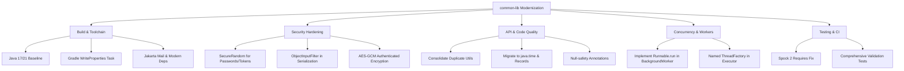

# Требования и скоуп

### Overview & Goals
Библиотека `common-lib` представляет собой набор переиспользуемых Java-утилит (работа с файлами, строками, датами, коллекциями, шифрованием, почтой, валидацией реквизитов и сериализацией).
Цель анализа — выявить архитектурные проблемы, уязвимости безопасности, устаревшие зависимости, дефекты многопоточности и сформировать пошаговый план модернизации библиотеки для повышения её надежности, безопасности и удобства использования в современных Java-проектах.

---

### Scope

#### In Scope (Что предлагается улучшить):
1. **Инфраструктура сборки и зависимости:**
   - Обновление baseline с Java 8 до Java 17/21 LTS.
   - Устранение побочных эффектов на этапе конфигурации Gradle (`build.properties` генерируется прямо в `src/main/resources`).
   - Актуализация библиотек (`commons-io`, `commons-lang3`, `slf4j`, `jackson-databind`, миграция `javax.mail` -> `jakarta.mail`).
2. **Безопасность и криптография:**
   - Защита от небезопасной Java-десериализации в `SerializationUtil`.
   - Использование `SecureRandom` вместо псевдослучайного `java.util.Random` для токенов и паролей (`RandPass`, `RandomHex`, `PasswordGenerator`).
   - Переход на аутентифицированное шифрование (AES-GCM) в крипто-утилитах.
   - Обновление устаревшей реализации `jBCrypt`.
3. **Архитектура и дизайн API:**
   - Устранение дублирования классов (`TZUtil` / `TimeZoneUtil`, `DateUtil` / `time.TimeUtil`, `HashUtil` / пакет `hash`).
   - Соблюдение принципа единственной ответственности (SRP): удаление строковых методов из `SerializationUtil`.
   - Переход с устаревшего `java.util.Date`/`Calendar` на `java.time.*`.
   - Использование Java `record` для DTO и пар значений (`Pair`, `Reference`, `ClientInfo`).
   - Внедрение аннотаций null-safety (`@NotNull`, `@Nullable`).
4. **Многопоточность и фоновые задачи:**
   - Исправление `BackgroundWorker` (отсутствие реализации метода `run()` из `Runnable`).
   - Улучшение `Executor` (фабрика именованных потоков, настраиваемая очередь).
5. **Тестирование:**
   - Исправление интеграционных тестов почты (`EmailSenderSpec`, `EmailReceiverSpec`) под Spock 2.x (устранение зависаний по таймауту).
   - Расширение покрытия для валидаторов и утилит безопасности.

#### Out of Scope:
- Полное переписывание библиотеки на другой язык (например, Kotlin).
- Удаление публичных методов без переходного периода `@Deprecated` (для сохранения обратной совместимости клиентских приложений).

---

### Key Requirements & Deliverables
- **Совместимость:** Обеспечить плавную миграцию существующих клиентов (депрекация устаревших методов перед удалением).
- **Безопасность:** Отсутствие уязвимостей CWE-502 (Deserialization of Untrusted Data) и CWE-330 (Use of Insufficiently Random Values).
- **Стабильность CI/CD:** Успешное и быстрое прохождение всех тестов без зависаний по таймаутам на внешних сетевых сервисах.

# Технический дизайн

### Current Implementation & Identified Issues

В ходе анализа кодовой базы выявлены следующие ключевые проблемы:

1. **Конфигурация сборки и версионирование (`build.gradle`):**
   - Проект компилируется под Java 8 (`release = 8`), в то время как используется Gradle 9.6.0, требующий JDK 17+.
   - Во время выполнения Gradle Configuration фазы запускается код:
     ```groovy
     project.ant.propertyfile(file: "${filePath}build.properties") { ... }
     ```
     который напрямую пишет в `src/main/resources/com/es/lib/common/build.properties`. Это загрязняет рабочий каталог git и ломает Gradle Configuration Cache / Up-to-Date checks.
   - Зависимости устарели: `commons-io:2.6` (2017 г.), `slf4j:1.7.29` (2019 г.), `commons-lang3:3.9`, `javax.mail:1.6.2` (устаревший namespace `javax.*`).

2. **Безопасность (Security & Cryptography):**
   - `SerializationUtil.java`:
     ```java
     public static <T> T toObject(byte[] arr, Class<T> clz) {
         try (ObjectInput in = new ObjectInputStream(new ByteArrayInputStream(arr))) {
             return (T) in.readObject();
         } catch (Exception ex) { return null; }
     }
     ```
     Классическая уязвимость небезопасной десериализации (RCE через gadget-цепочки). Кроме того, `toObject` и `toArray` молча проглатывают любые исключения и возвращают `null`.
     Также метод `removeDelimiters(String)` почему-то находится в классе сериализации.
   - `RandPass.java` и `RandomHex.java`:
     Используют `java.util.Random` вместо `java.security.SecureRandom`, что делает сгенерированные пароли и токены предсказуемыми.
   - `CipherAES.java`:
     Использует стандартный режим шифрования без контроля целостности (рекомендуется AES-GCM).

3. **Многопоточность (Concurrency):**
   - `BackgroundWorker.java`:
     Класс объявлен как `public abstract class BackgroundWorker implements Runnable`, но не реализует метод `public void run()`, а определяет лишь `protected void process()`.
   - `Executor.java`:
     Использует фиксированный `LinkedBlockingQueue(1000)` без настройки `ThreadFactory` (потоки создаются без информативных имен), а `DEFAULT_MAX_POOL_SIZE = 200` является избыточным значением по умолчанию для неблокирующих задач.

4. **Дублирование и устаревшие API:**
   - Наличие дублирующих классов: `TZUtil.java` и `time/TimeZoneUtil.java`, `DateUtil.java` и `time/TimeUtil.java`, `HashUtil.java` и классов в пакете `com.es.lib.common.hash.*`.
   - Широкое использование устаревших `java.util.Date`, `Calendar` и непотокобезопасного `SimpleDateFormat`.

5. **Тесты (`src/test/groovy/...`):**
   - `EmailSenderSpec.groovy` использует Spock 2.x, но условие `@IgnoreIf({ System.getProperty(...) == null })` вычисляется неверно в контексте Spock 2 precondition context, из-за чего тесты пытаются реально слать письма на `memphisprogramming@gmail.com` и падают по таймауту в 300 секунд при локальном запуске или в CI.

---

### Proposed Architecture & Solutions



### Key Decisions

1. **Baseline Java 17 LTS:**
   - *Решение:* Поднять минимальную версию Java до 17.
   - *Обоснование:* Поддержка Java `record`, `sealed classes`, `Pattern Matching`, улучшенной производительности JVM, актуального Gradle и современных библиотек.

2. **Защита десериализации:**
   - *Решение:* Внедрить `ObjectInputFilter` в `SerializationUtil`, пометить стандартную Java-сериализацию как `@Deprecated` и рекомендовать использовать `JsonUtil` / Jackson.
   - *Обоснование:* Предотвращение критических уязвимостей удаленного выполнения кода.

3. **Криптографическая безопасность:**
   - *Решение:* Заменить генераторы случайных чисел на `SecureRandom`, перевести симметричное шифрование на режим GCM (`AES/GCM/NoPadding`).
   - *Обоснование:* Соответствие современным стандартам безопасности OWASP и NIST.

4. **Генерация ресурсов в Gradle:**
   - *Решение:* Создать отдельную задачу `task generateBuildProperties(type: WriteProperties)` с выводом в `$buildDir/generated/resources`, подключив её к `processResources`.
   - *Обоснование:* Чистый рабочий каталог, поддержка инкрементальной сборки и Configuration Cache.

# Тестирование

### Validation Approach
Все изменения должны проверяться автоматически через Spock-спецификации и запуск тестов Gradle.

---

### Key Scenarios

1. **Сборка и Gradle задачи:**
   - Выполнение `./gradlew check` без обращения к внешним почтовым сервисам.
   - Проверка чистоты репозитория: `git status` не должен показывать измененных файлов после запуска сборки (генерация свойств только в `build/`).

2. **Безопасность и сериализация:**
   - Unit-тесты для `SerializationUtil`: корректная десериализация разрешенных классов и блокировка неразрешенных с выбрасыванием понятного исключения.
   - Тесты для `RandPass`, `RandomHex`, `PasswordGenerator`: проверка энтропии, длины и разнообразия символов.

3. **Многопоточность:**
   - Тестирование `BackgroundWorker`: проверка вызова `process()` при вызове `run()`, обработка ошибок через `doOnError()`.
   - Тестирование `Executor`: корректное завершение потоков при `shutdownAndAwaitTermination` и отсутствие утечек ресурсов.

4. **Утилиты валидации и форматирования:**
   - Тесты для ИНН (10 и 12 знаков), КПП, ОГРН, СНИЛС на валидных и невалидных контрольных суммах.
   - Тесты для `CaseConverter`, `Declension`, `Pluralizer` и `MoneyToStr` на граничных значениях (ноль, отрицательные суммы, большие числа).

5. **Spock 2 совместимость:**
   - Проверка корректного пропуска интеграционных тестов почты при отсутствии системных свойств:
     ```groovy
     @Requires({ sys['test_email_server'] && sys['test_email_login'] })
     ```

# Delivery Steps

###   Step 1: Модернизация сборки и зависимостей
Обновить билд-скрипты, версию JDK и устаревшие библиотеки.

- Обновить `sourceCompatibility` и `targetCompatibility` до Java 17 (или Java 21 LTS).
- Исправить сайд-эффекты на фазе конфигурации в `build.gradle` (генерация `build.properties` через задачу Gradle `WriteProperties`/`ProcessResources` вместо прямого создания файлов в `src/main/resources`).
- Обновить зависимости: `commons-io` до 2.18+, `commons-lang3` до 3.17+, `slf4j` до 2.0+, `jackson-databind` до актуальной 2.18+.
- Мигрировать с устаревшего `com.sun.mail:javax.mail:1.6.2` на современный `jakarta.mail:jakarta.mail-api` (Jakarta EE 10+).
- Устранить предупреждения депрекаций Gradle 9/10.

###   Step 2: Устранение уязвимостей безопасности и криптографии
Устранить потенциальные уязвимости в сериализации, генераторах паролей и шифровании.

- В `SerializationUtil` отказаться от небезопасной Java-десериализации по умолчанию или внедрить `ObjectInputFilter` для фильтрации классов при `ObjectInputStream.readObject()`, а также перестать глотать `Exception` с возвратом `null`.
- Заменить `java.util.Random` на `java.security.SecureRandom` в `RandPass`, `RandomHex` и `PasswordGenerator` для генерации криптографически стойких токенов и паролей.
- Пересмотреть `CipherAES`, `CipherRSA` и `RSASigner`: добавить поддержку современных режимов шифрования (AES-GCM вместо устаревших/небезопасных режимов без аутентификации).
- Заменить устаревшую библиотеку `jBCrypt` (2015 года) на актуальную реализацию (например, Spring Security Crypto или Bouncy Castle).

###   Step 3: Рефакторинг API, переход на java.time и Java Records
Устранить дублирование классов, перевести работу с датами на java.time и модели на records.

- Устранить дублирующиеся утилиты: объединить `TZUtil` и `TimeZoneUtil`, выстроить единую структуру между `DateUtil` и `time.TimeUtil`, `HashUtil` и пакетом `hash.*`.
- Вынести `removeDelimiters`/`replaceDelimiters` из `SerializationUtil` в `StringUtil` / `text.CaseConverter`.
- Полностью перевести работу со временем и датами с устаревших `java.util.Date`, `Calendar`, `SimpleDateFormat` на `java.time.*` (`LocalDate`, `LocalDateTime`, `Instant`, `DateTimeFormatter`, `ZoneId`).
- Перевести иммутабельные структуры данных (`Pair`, `Reference`, `NamedPair`, `ClientInfo`, `DiscInfo`, `StatInfo`) на Java `record`.
- Внедрить аннотации нуллабельности (например, JSpecify / JetBrains Annotations `@NotNull`, `@Nullable`) для всего публичного API.

###   Step 4: Исправление многопоточности и BackgroundWorker
Исправить реализацию фоновых процессов и многопоточных утилит.

- В `BackgroundWorker` явно реализовать контракт `public void run() { process(); }` интерфейса `Runnable`.
- В `Executor` добавить настройку очереди (`BlockingQueue`), гибкое управление жизненным циклом потоков и именование пулов через `ThreadFactory`.
- Провести аудит `LimitedQueue`, `SafeMap` и `CacheProvider` на предмет потокобезопасности, отсутствия гонок и блокировок при конкурентном доступе.

###   Step 5: Стабилизация и расширение тестового покрытия
Исправить падающие интеграционные тесты и повысить надежность тестового набора.

- В `EmailSenderSpec` и `EmailReceiverSpec` исправить синтаксис Spock 2 для условного выполнения (`@Requires({ sys['test_email_server'] })` вместо некорректного `@IgnoreIf`), чтобы исключить таймауты и зависания тестов при сборке без почтового сервера.
- Расширить покрытие unit-тестами для валидаторов (`InnValidator`, `KppValidator`, `OgrnValidator`, `SnilsValidator`), криптографических утилит и граничных условий работы с файлами и потоками.
- Настроить проверку покрытия кода через JaCoCo с минимальными порогами для критических пакетов.